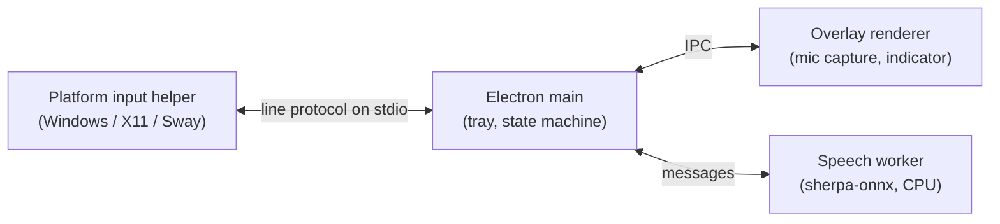

<div align="center">

# Chirp

**Offline push-to-talk dictation. Hold a key, speak, release, and your words appear.**


[Features](#features) · [Quick start](#quick-start) · [Usage](#usage) · [Models](#speech-models) · [Build](#build-from-source) · [How it works](#how-it-works) · [Contributing](#contributing)

</div>

---

Chirp is a small tray app. Hold **Right Alt**, speak, and release. Chirp transcribes your speech on your CPU and tries to paste the text into the window where you started. Recordings and transcripts are processed locally, and Chirp keeps no history.

## Features

- **Fully offline.** Both speech models run locally on the CPU through [sherpa-onnx](https://github.com/k2-fsa/sherpa-onnx). Building from source requires downloading dependencies and model files.
- **Global push-to-talk.** Start a dictation from another app and paste into its focused text field when the app accepts the paste shortcut.
- **Two speech models.** Qwen3-ASR 0.6B (multilingual, the default) and Parakeet TDT 0.6B v3 (faster, 25 European languages).
- **Streaming or whole-recording mode.** Press `Ctrl+N` to choose how the next dictation is processed. Both modes try to paste once on release.
- **Auto-Enter.** Press `Ctrl+B` on Windows or X11 to toggle pressing Enter after a confirmed paste.
- **Safe paste.** If you switch windows, Chirp leaves the text on the clipboard instead of pasting into the wrong place.
- **Clipboard restore.** After a successful paste on Windows, Chirp restores your previous clipboard contents when possible.
- **Terminal-aware.** Uses `Ctrl+Shift+V` for Windows Terminal and recognized Linux terminals.
- **Private by design.** No account, no telemetry, no transcript history.

## Supported platforms

| Platform | Status | Notes |
| --- | --- | --- |
| Windows x64 | Supported | NSIS installer, starts at sign-in. Tested on Windows 11. The installer is unsigned. |
| Linux x64, X11 | Supported | Portable `tar.gz`. Uses XInput2 and XTEST. |
| Linux x64, Sway (Wayland) | Supported | Needs `wl-clipboard` and `wtype`. Auto-Enter is unavailable. |
| Other Wayland compositors, macOS | Not supported | |

## Quick start

### Windows

1. Run `Chirp Setup.exe`, review the terms, and choose **I Agree**. Setup installs Chirp and both models for your account and launches Chirp.
2. Look for the Chirp icon in the system tray. Its tooltip shows when the model is ready.
3. Click a text field, hold **Right Alt**, speak, and release.

To remove Chirp, use **Settings → Apps → Installed apps**.

### Linux (X11)

Extract the archive and run `chirp-dictation` inside your X11 session.

### Linux (Sway)

1. Install `wl-clipboard` and `wtype`.
2. Include the bundled configuration in your Sway config:

   ```text
   include "/absolute/path/to/Chirp/resources/chirp-sway.conf"
   ```

   From a source checkout, use `native/linux/chirp-sway.conf`.
3. Run `swaymsg reload`, then launch `chirp-dictation`.

The included file registers the shortcuts in Sway itself and keeps the indicator from taking keyboard focus. The bindings stay active while the file is included. Adjust them if they conflict with your own.

## Usage

| Shortcut | Action |
| --- | --- |
| Hold **Right Alt** | Record. Release to transcribe and paste. |
| `Ctrl+B` | Toggle **Auto-Enter** (off on every launch; unavailable on Sway). |
| `Ctrl+N` | Switch between **Streaming** and **Whole recording**. |
| `Ctrl+Q` | Quit Chirp. The tray menu also has **Quit Chirp**. |
| Right Alt + another key | Cancel the current recording on Windows or X11. |

The indicator at the top center of the screen shows the current state:

| State | Meaning |
| --- | --- |
| **Starting** | The microphone is opening. |
| **Listening** | Audio is arriving. Speak now. |
| **Transcribing** | You released the key and Chirp is working. |
| **Copied** | The text is on the clipboard for manual paste. |

If you switch windows before the paste, or return after switching away, Chirp leaves the transcript on the clipboard. Chirp uses the default system microphone.

When Auto-Enter is on, Chirp waits 600 ms after the original window reads the pasted text, then presses Enter. If you changed windows or pressed a key in the meantime, it skips Enter.

On both Linux backends, Chirp uses `Ctrl+Shift+V` for terminals. If your terminal uses another paste binding, paste manually from the clipboard.

## Speech models

| | Qwen3-ASR 0.6B | Parakeet TDT 0.6B v3 |
| --- | --- | --- |
| Setting | `qwen` (default) | `parakeet`, `parakeet-streaming` |
| Languages | 30, including English, German, Arabic | 25 European languages |
| Speed (CPU) | Slower | Faster |
| Publisher | Qwen team | NVIDIA |
| License | Apache 2.0 | CC BY 4.0 |

On the same laptop, recognizing an 88-second noisy English clip took 23.8 s with Qwen and 3.1 s with Parakeet. Results vary by voice, microphone, and hardware. See the full [model comparison and verification notes](docs/verification.md).

Choose a model with the `CHIRP_ASR_MODEL` environment variable. Chirp loads it at startup.

**Windows (installed copy).** Quit Chirp with `Ctrl+Q` and replace the executable path below with the path to your installed copy.

```powershell
$model = 'parakeet'   # or 'qwen' or 'parakeet-streaming'
[Environment]::SetEnvironmentVariable('CHIRP_ASR_MODEL', $model, 'User')
$env:CHIRP_ASR_MODEL = $model
$chirp = 'C:\path\to\Chirp.exe'
& $chirp
```

**Windows (source checkout).**

```powershell
$env:CHIRP_ASR_MODEL = 'parakeet-streaming'
npm start
```

**Linux.** Select the model when launching the packaged app or when starting from source.

```sh
CHIRP_ASR_MODEL=parakeet-streaming ./chirp-dictation
CHIRP_ASR_MODEL=parakeet-streaming npm run start:linux  # from source
```

`parakeet-streaming` selects Parakeet and starts Chirp in streaming mode. In that mode, Chirp processes phrases while you speak, uses pauses and quiet points to split audio, and tries to paste once on release. You can also toggle streaming with `Ctrl+N` after loading either model.

## Build from source

### Requirements

| Tool | Version |
| --- | --- |
| Node.js | 24 or newer |
| Electron | 45.4.1 (installed by `npm ci`) |
| TypeScript | 5.9.3 (installed by `npm ci`) |
| sherpa-onnx-node | 1.12.36 (installed by `npm ci`) |

- **Windows:** x64, Visual Studio Build Tools with the **Desktop development with C++** workload and the Windows SDK.
- **Linux:** x64, a C++ compiler, and development libraries for X11, XInput2, and XTEST. On Debian and Ubuntu: `build-essential libx11-dev libxi-dev libxtst-dev`.

### Windows

```powershell
npm ci
npm run models   # download and verify both models into models\
npm start        # build and run
npm run dist     # produce dist\Chirp Setup.exe
```

### Linux

```sh
npm ci
npm run models
npm run start:linux
npm run dist:linux   # produce a portable tar.gz in dist/
```

`npm run models` downloads the pinned sherpa-onnx model conversions, checks their SHA-256 hashes, and extracts them into `models/`. Verified archives are reused from `build/downloads/`. Git tracks source, packaging configuration, and the lockfile. Build outputs and model weights stay local.

### Scripts

| Script | Purpose |
| --- | --- |
| `npm start` / `npm run start:linux` | Build and launch from source |
| `npm run build` | Compile TypeScript to `out/` |
| `npm test` | Build and run the unit tests |
| `npm run lint` | Type-check with unused-code checks |
| `npm run check:format` / `npm run format` | Check or apply Prettier formatting |
| `npm run compare` | Benchmark both models on sample recordings |
| `npm run test:capture` / `npm run test:paste` | Interactive Windows checks |
| `npm run dist` / `npm run dist:linux` | Package for Windows or Linux |

## How it works



1. A platform helper reports Right Alt presses and releases to the main process. On Windows and X11 it also reports cancelled recordings.
2. The overlay captures 16 kHz microphone audio through an AudioWorklet and sends it to the main process.
3. A speech worker, running in its own process, transcribes the audio with the selected model.
4. The main process sends the text back to the helper, which puts it on the clipboard. The helper sends the paste shortcut if focus stayed in the original window and the target supports automatic paste.

### Repository layout

| Path | Responsibility |
| --- | --- |
| `src/main` | Tray icon, overlay window, shortcuts, and the dictation lifecycle |
| `src/preload`, `src/renderer` | Microphone capture, audio worklet, and overlay UI |
| `src/speech` | Speech worker, shared recognizer interface, and model adapters |
| `native/windows` | Keyboard and focus hooks, clipboard delivery, and sign-in registration |
| `native/linux` | X11 input helper and Sway configuration |
| `scripts` | Model download, native helper builds, model comparison |
| `tests` | Recognition, clipboard, desktop, and installer checks |
| `docs` | Verification notes and benchmarks |

## Testing

```sh
npm test
npm run lint
npm run check:format
```

The interactive Windows checks (capture, paste, clipboard, desktop targets, installer) are listed in [docs/verification.md](docs/verification.md).

## Privacy

- Chirp processes audio and text in memory without saving a history. Transcripts can remain on the system clipboard after dictation.
- Speech recognition runs on the device without uploading audio or transcripts.
- On Windows, Chirp marks copied transcripts for exclusion from clipboard history.

## Known limitations

- Windows installers are unsigned, so SmartScreen may warn.
- Only Sway is supported on Wayland. Other compositors are rejected at startup.
- Auto-Enter is unavailable on Sway.
- Chirp pastes plain text without timestamps. Use Qwen for Arabic dictation.

## Contributing

Issues and pull requests are welcome. Before opening a pull request, run `npm test`, `npm run lint`, and `npm run check:format`.

## License and third-party notices

Chirp's terms are in `native/windows/terms.txt`, which the installer shows and installs as `Chirp Terms.txt`. The bundled models and runtime have their own licenses:

- [NVIDIA Parakeet TDT 0.6B v3](https://huggingface.co/nvidia/parakeet-tdt-0.6b-v3), CC BY 4.0, converted to ONNX by [sherpa-onnx](https://github.com/k2-fsa/sherpa-onnx)
- [Qwen3-ASR 0.6B](https://huggingface.co/Qwen/Qwen3-ASR-0.6B), Apache 2.0
- [sherpa-onnx](https://github.com/k2-fsa/sherpa-onnx), Apache 2.0
