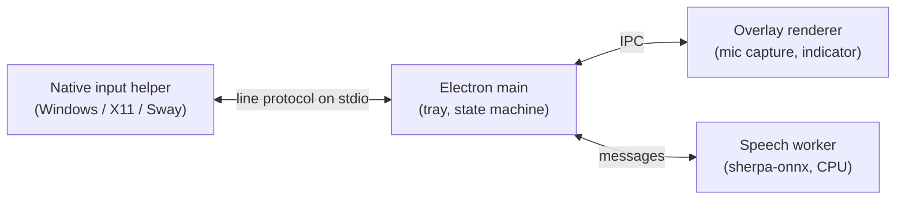

<div align="center">


# Chirp

### Offline push-to-talk dictation for Windows and Linux. Hold a key, speak, release.

[**Install**](#installation) • [**Usage**](#usage) • [**Speech Models**](#speech-models) • [**Build from Source**](#build-from-source) • [**How It Works**](#how-it-works) • [**Performance**](#performance) • [**Contributing**](#contribution-and-support)


</div>

Chirp is a small tray app that turns speech into text anywhere you can type. Hold **Right Alt**, speak, and release. Chirp transcribes on your own CPU and pastes the text into the window where you started. Recordings and transcripts stay in memory, and Chirp keeps no history.

- **Fully Offline**: Both speech models run locally on the CPU through [sherpa-onnx](https://github.com/k2-fsa/sherpa-onnx). Chirp makes no network requests while running.
- **Works Everywhere**: The shortcut is global and pastes into whichever text field had focus, including terminals (`Ctrl+Shift+V`).
- **Two Speech Models**: Qwen3-ASR 0.6B for 30 languages (default) and Parakeet TDT 0.6B v3 for faster results in 25 European languages.
- **Safe Paste**: If you switch windows, Chirp leaves the text on the clipboard instead of pasting into the wrong place. On Windows it restores your previous clipboard after a successful paste.
- **Streaming or Whole Recording**: Process phrases while you speak, or process the audio on release. Switch with `Ctrl+N`.
- **Auto-Enter**: Optionally press Enter after pasting. Toggle with `Ctrl+B`.

Check out the [Shortcuts](#shortcuts) and [Speech Models](#speech-models) for a quick reference.

## Installation

| Platform | Package | Notes |
| --- | --- | --- |
| Windows 10/11 x64 | `Chirp Setup.exe` | Per-user install, starts at sign-in. The installer is unsigned. |
| Linux x64, X11 | Portable `tar.gz` | Uses XInput2 and XTEST. |
| Linux x64, Sway (Wayland) | Portable `tar.gz` | Needs `wl-clipboard` and `wtype`. Auto-Enter is unavailable. |

Other Wayland compositors and macOS are not supported.

### Windows

1. Run `Chirp Setup.exe`, review the terms, and choose **I Agree**. Setup installs Chirp and both models for your account, then launches Chirp.
2. Find the Chirp icon in the system tray. Its tooltip shows when the model is ready.
3. Click a text field, hold **Right Alt**, speak, and release.

To remove Chirp, use **Settings → Apps → Installed apps**.

### Linux (X11)

Extract the archive and run `chirp-dictation` in your X11 session.

### Linux (Sway)

Install `wl-clipboard` and `wtype`, then include the bundled configuration in your Sway config:

```text
include "/absolute/path/to/Chirp/resources/chirp-sway.conf"
```

From a source checkout, use `native/linux/chirp-sway.conf`. Run `swaymsg reload`, then launch `chirp-dictation`. The included file registers the shortcuts in Sway itself and keeps the indicator from taking keyboard focus. Adjust the bindings if they conflict with your own.

## Usage

Click a text field, hold **Right Alt**, speak, and release. Chirp uses the default system microphone and pastes into the window you started in.

### Shortcuts

| Shortcut | Action |
| --- | --- |
| Hold **Right Alt** | Record. Release to transcribe and paste. |
| Right Alt + any other key | Cancel the current recording. |
| `Ctrl+B` | Toggle **Auto-Enter**. It starts off on every launch and is unavailable on Sway. |
| `Ctrl+N` | Switch between **Streaming** and **Whole recording**. |
| `Ctrl+Q` | Quit Chirp. The tray menu also has **Quit Chirp**. |

### Indicator

A small indicator at the top center of the screen shows what Chirp is doing.

| State | Meaning |
| --- | --- |
| **Starting** | The microphone is opening. |
| **Listening** | Audio is arriving. Speak now. |
| **Transcribing** | You released the key and Chirp is working. |
| **Copied** | The text is on the clipboard for manual paste. |

### Paste behavior

- If you switch windows before the paste finishes, or switch away and back, Chirp leaves the transcript on the clipboard.
- With Auto-Enter on, Chirp waits 600 ms after the original window reads the pasted text, then presses Enter. It skips Enter if you changed windows or pressed a key in between.
- Chirp uses `Ctrl+Shift+V` for terminals. If your terminal uses another binding, paste manually from the clipboard.

## Speech Models

Chirp loads one model at startup, chosen with the `CHIRP_ASR_MODEL` environment variable.

| Setting | Model | Languages | Publisher | License |
| --- | --- | --- | --- | --- |
| `qwen` (default) | Qwen3-ASR 0.6B | 30, including English, German, Arabic | Qwen team | Apache 2.0 |
| `parakeet` | Parakeet TDT 0.6B v3 | 25 European languages | NVIDIA | CC BY 4.0 |
| `parakeet-streaming` | Parakeet TDT 0.6B v3 | 25 European languages | NVIDIA | CC BY 4.0 |

`parakeet-streaming` is optional. It transcribes phrases in the background while you speak, ends a phrase at a pause, and splits continuous speech near a quiet point. It still pastes once, on release.

### Switch models

**Windows (installed copy).** Quit Chirp with `Ctrl+Q`, then run:

```powershell
$model = 'parakeet'   # or 'qwen'
[Environment]::SetEnvironmentVariable('CHIRP_ASR_MODEL', $model, 'User')
$env:CHIRP_ASR_MODEL = $model
$chirp = (Get-ItemPropertyValue 'HKCU:\Software\Microsoft\Windows\CurrentVersion\Run' 'Chirp').Trim('"')
& $chirp
```

**Linux or a source checkout.**

```sh
CHIRP_ASR_MODEL=parakeet npm run start:linux
```

## Build from Source

### Requirements

| Tool | Version |
| --- | --- |
| Node.js | 24 or newer |
| Electron | 45.4.1 |
| TypeScript | 5.9.3 |
| sherpa-onnx-node | 1.12.36 |

The last three install with `npm ci`.

- **Windows**: x64, Visual Studio Build Tools with the **Desktop development with C++** workload, and the Windows SDK.
- **Linux**: x64, a C++ compiler, and development libraries for X11, XInput2, and XTEST. On Debian and Ubuntu: `build-essential libx11-dev libxi-dev libxtst-dev`.

### Windows

```powershell
npm ci
npm run models   # download and verify both models into models\
npm start        # build and run
npm run dist     # produce dist\Chirp Setup.exe
```

### Linux

```sh
npm ci
npm run models
npm run start:linux
npm run dist:linux   # produce a portable tar.gz in dist/
```

`npm run models` downloads the pinned sherpa-onnx model conversions, checks their SHA-256 hashes, and extracts them into `models/`. Verified archives are reused from `build/downloads/`. Git tracks source, packaging configuration, and the lockfile. Build outputs and model weights stay local.

### Scripts

| Script | Purpose |
| --- | --- |
| `npm start` / `npm run start:linux` | Build and launch from source |
| `npm run build` | Compile TypeScript to `out/` |
| `npm test` | Build and run the unit tests |
| `npm run lint` | Type-check with unused-code checks |
| `npm run check:format` / `npm run format` | Check or apply Prettier formatting |
| `npm run compare` | Benchmark both models on sample recordings |
| `npm run test:capture` / `npm run test:paste` | Interactive Windows checks |
| `npm run dist` / `npm run dist:linux` | Package for Windows or Linux |

## How It Works



1. A native helper watches **Right Alt** and reports `down`, `up`, and `cancel` events to the main process.
2. The overlay captures 16 kHz microphone audio through an AudioWorklet and sends it to the main process.
3. A speech worker, in its own process, transcribes the audio with the selected model.
4. The main process sends the text to the helper, which puts it on the clipboard and sends the paste shortcut only if the original window is still focused.

## Performance

On one Intel Core Ultra 9 275HX laptop with four CPU threads, recognition time after the audio was available:

| Recording | Qwen | Parakeet |
| --- | ---: | ---: |
| Noisy English, 88.19 s | 23.80 s | 3.06 s |
| German, 6.72 s | 1.08 s | 0.24 s |
| Arabic, 5.25 s | 1.23 s | 0.23 s |

Qwen matched the German reference and produced Arabic text, while Parakeet wrote a phonetic Latin rendering of the Arabic. Results vary with your voice, microphone, and hardware. Reproduce them with `npm run compare`. The [verification notes](docs/verification.md) cover the full comparison, streaming benchmarks, and Windows checks.

## Documentation

| Document | Contents |
| --- | --- |
| [docs/verification.md](docs/verification.md) | Model comparison, streaming benchmarks, and how to repeat the Windows checks |
| [`native/windows/terms.txt`](native/windows/terms.txt) | Terms and third-party notices, installed as `Chirp Terms.txt` |

## Repository Layout

| Path | Responsibility |
| --- | --- |
| `src/main` | Tray icon, overlay window, shortcuts, and the dictation lifecycle |
| `src/preload`, `src/renderer` | Microphone capture, audio worklet, and overlay UI |
| `src/speech` | Speech worker, shared recognizer interface, and model adapters |
| `native/windows` | Keyboard and focus hooks, clipboard delivery, and sign-in registration |
| `native/linux` | X11 input helper and Sway configuration |
| `scripts` | Model download, native helper builds, model comparison |
| `tests` | Recognition, clipboard, desktop, and installer checks |
| `docs` | Verification notes and benchmarks |

## Known Limitations

- Windows installers are unsigned, so SmartScreen may warn.
- Only Sway is supported on Wayland. Other compositors are rejected at startup.
- Auto-Enter is unavailable on Sway.
- Qwen3-ASR returns text without timestamps, and Parakeet does not support Arabic.

## Contribution and Support

Issues and pull requests are welcome. Before opening a pull request, run:

```sh
npm test
npm run lint
npm run check:format
```

The interactive Windows checks (capture, paste, clipboard, desktop targets, installer) are listed in [docs/verification.md](docs/verification.md).

## Privacy

- Audio and transcripts exist only in memory while a recording is processed.
- Chirp makes no network requests while running. Only `npm run models` downloads files.
- On Windows, fallback clipboard text carries the clipboard-history exclusion marker.

## License

Chirp's terms are in [`native/windows/terms.txt`](native/windows/terms.txt). The bundled models and runtime have their own licenses:

- [NVIDIA Parakeet TDT 0.6B v3](https://huggingface.co/nvidia/parakeet-tdt-0.6b-v3): CC BY 4.0, converted to ONNX by [sherpa-onnx](https://github.com/k2-fsa/sherpa-onnx)
- [Qwen3-ASR 0.6B](https://huggingface.co/Qwen/Qwen3-ASR-0.6B): Apache 2.0
- [sherpa-onnx](https://github.com/k2-fsa/sherpa-onnx): Apache 2.0
